# Отчет по ДЗ 2.3

## 1. Данные и окружение

Для расчетов использован набор `demo`: 6000 событий, 100 пользователей, `seed=42`. События относятся к периоду с 01.01.2026 по 01.02.2026, рассылки загружаются из `data/demo/campaigns.csv`. Между запусками исходные данные не изменялись

Окружение: Apache Airflow 2.10.5, PySpark 3.5.4, Hadoop 3.3.4, Java 17, PostgreSQL 16.6 и RustFS 1.0.4. Spark работает в режиме `local[2]`, время обработки — UTC. Порядок запуска приведен в `README.md`

## 2. DAG и расписание

DAG `hw_2_3_scd2_campaigns` содержит две задачи с зависимостью:

```text
build_user_scd2 -> build_campaign_recipients
```

Установлено расписание на 00:00 UTC, `catchup=True`, `max_active_runs=1` и одна повторная попытка при ошибке. Обрабатываются три суточных интервала `[data_interval_start, data_interval_end)`:

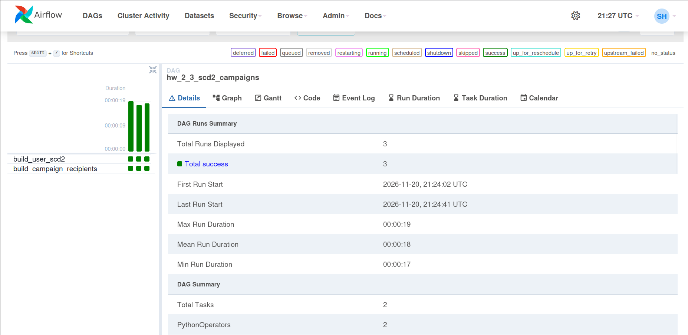

Идентификаторы запусков:
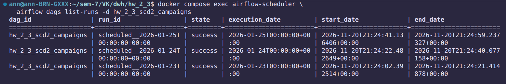

Все три запуска созданы планировщиком Airflow. В каждом успешно выполнились обе задачи

## 3. SCD2

Для каждой даты выбираются все события с `event_time < data_interval_end`. События одного пользователя сортируются по `event_time`. Новая версия создается только при изменении ФИО, почты или логина. Предыдущая версия закрывается временем начала следующей, а последняя остается открытой (`valid_to = NULL`, `is_current = true`). Результат для каждой даты сохраняется отдельно в `user_scd2/snapshot_date=D/`

Получены следующие результаты:

| Дата D | Версий SCD2 | Пользователей | Текущих версий |
| --- | ---: | ---: | ---: |
| 2026-01-23 | 961 | 100 | 100 |
| 2026-01-24 | 995 | 100 | 100 |
| 2026-01-25 | 1036 | 100 | 100 |

Скрипт `jobs/check_results.py` проверил уникальность ключа `(user_id, valid_from)`, отсутствие пересечений интервалов и лишних версий, наличие одной текущей версии для каждого пользователя и отсутствие будущих событий. Проверки выполнены успешно

Дополнительно на наборе `fixtures` проверены граничные случаи: 23 января — 3 версии SCD2, 24 января — 6, 25 января — 10, 27 января — 12:
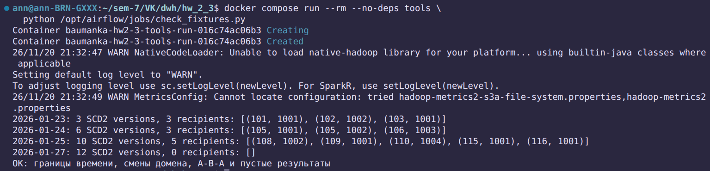

## 4. Исторический JOIN

Задача `build_campaign_recipients` читает SCD2-снимок за ту же дату D. Из рассылок выбираются записи с `data_interval_start ≤ send_at < data_interval_end`. Пользователь подходит для рассылки, если домен его почты совпадает с доменом рассылки без учета регистра и момент отправки находится внутри интервала действия соответствующей версии профиля: `valid_from ≤ send_at < valid_to` либо `valid_to IS NULL`

Результаты по рассылкам:

| Дата D | campaign_id | Получателей |
| --- | --- | ---: |
| 2026-01-23 | 11 — 10; 16 — 23; 23 — 20 | 53 |
| 2026-01-24 | 21 — 25 | 25 |
| 2026-01-25 | 19 — 22 | 22 |

Проверка `jobs/check_results.py` подтвердила отсутствие дублей `(campaign_id, user_id)` и правильность получателей по бизнес-полям. На `fixtures` отдельно проверены смена домена, точные временные границы, дата до первого события пользователя, сравнение домена без учета регистра, возврат A–B–A и пустая выдача

В логе Spark получен физический план с `BroadcastHashJoin Inner BuildLeft`. Небольшая таблица рассылок передается через `BroadcastExchange`, после чего присоединяется к истории пользователей, прочитанной из Parquet. Для данного набора это подходящая стратегия, т.к. рассылок за сутки мало, поэтому их можно передать исполнителям без перераспределения большой таблицы SCD2. Фактический план:
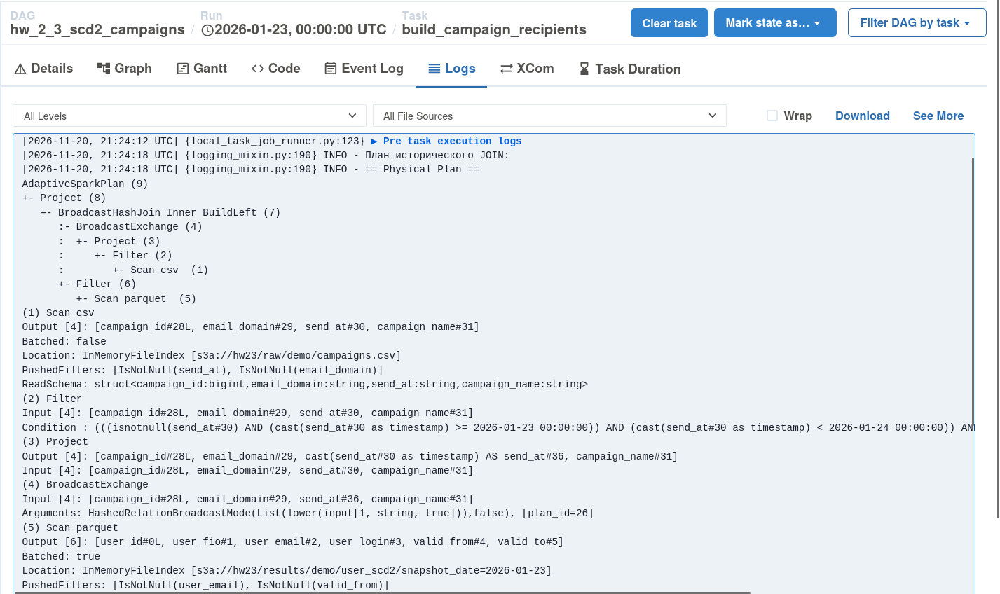

## 5. Метаполя

Обе таблицы содержат непустые поля `_dag_id`, `_run_id`, `_task_id`, `_data_interval_start`, `_data_interval_end` и `_loaded_at`. Поля запуска формируются из контекста Airflow. Для обеих задач одной даты совпадают `_run_id` и границы интервала, а `_task_id` соответствует задаче, сформировавшей таблицу. Значение `_loaded_at` одинаково для всех строк результата одной попытки задачи

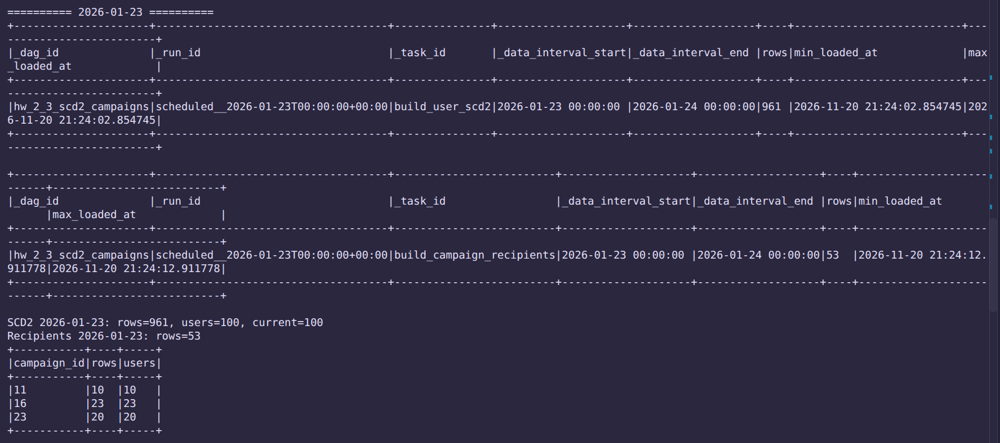
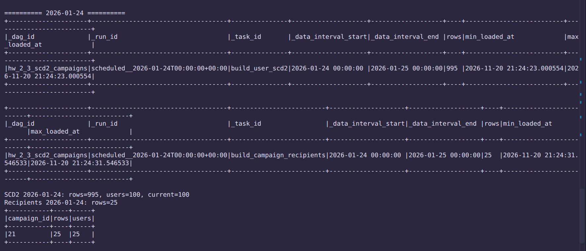
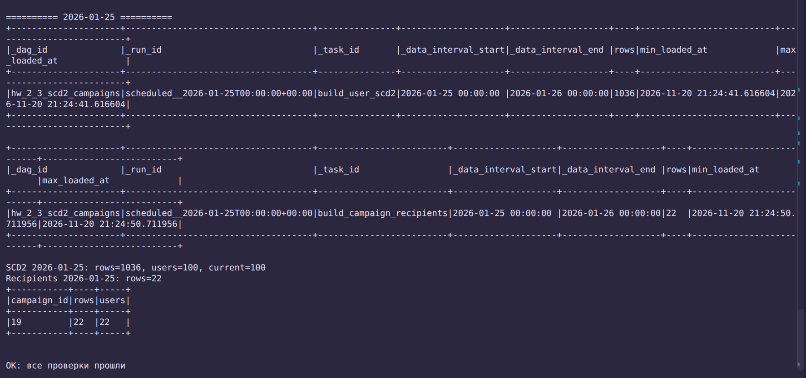

Значение `_dag_id` для всех строк — `hw_2_3_scd2_campaigns`; `_run_id` соответствует одной из трех строк раздела 2, `_data_interval_start` и `_data_interval_end` — границам соответствующего интервала. Проверены типы и отсутствие NULL в метаполях, а также согласованность метаполей между задачами

## 6. Повторный запуск

До повторной обработки сохранены резервные копии всех шести партиций в `s3a://hw23/backups/demo/before_repeat/`:
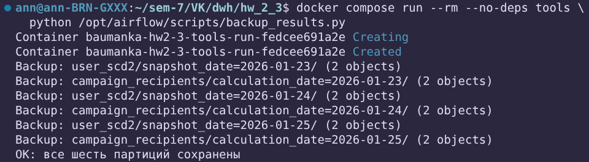 

После этого в Airflow выполнено `Clear` двух задач запуска за 23 января. В журнале видно, что обе задачи успешно завершились второй раз (`TRY NUMBER = 2`), при этом новый DAG run не создавался:
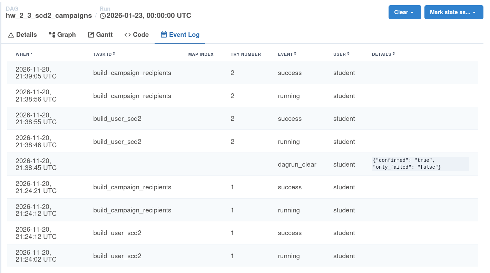

После повторной обработки выполнен `check_results.py --compare-backup`. Сравнение через `exceptAll` в обе стороны дало следующие результаты:

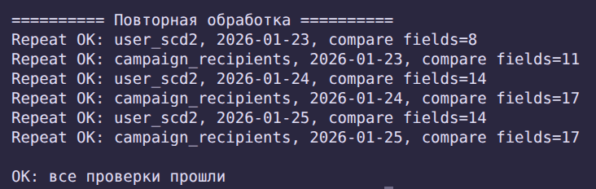

Для 23 января совпали все бизнес-поля и поле даты; метаполя были исключены из сравнения, поскольку `_loaded_at` при повторе может измениться. Для 24 и 25 января совпали все поля, включая метаполя. Следовательно, повторная обработка не добавила дубли, не изменила бизнес-результат и не затронула другие дни

## 7. Результат

Таблицы `user_scd2` и `campaign_recipients` сохранены в RustFS в формате Parquet, в каталоге `s3a://hw23/results/demo/` с раздельными партициями по трем датам. Через `scripts/export_results.py` выгружены шесть Parquet-файлов в локальную папку `exports/results/demo/` — по одному для каждой таблицы и даты:
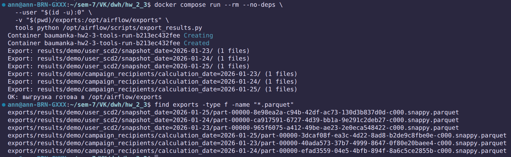

